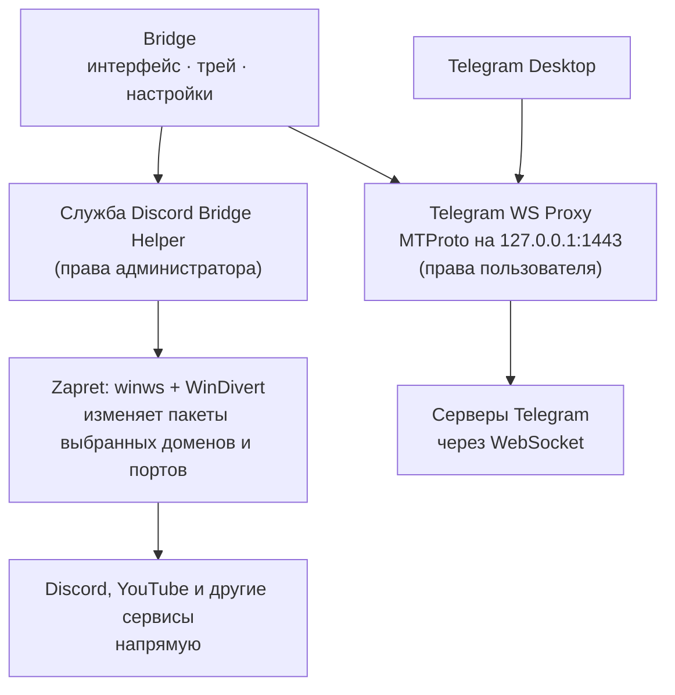

<div align="center">


# Bridge

**Обход блокировок Discord, YouTube и Telegram в одном приложении для Windows**

Bridge управляет [Flowseal Zapret](https://github.com/Flowseal/zapret-discord-youtube) и
[Telegram WS Proxy](https://github.com/Flowseal/tg-ws-proxy) из понятного интерфейса:
без ручного скачивания архивов, BAT-файлов и командной строки.

[](https://github.com/stardely62-oss/discord-bridge/releases)
[](#установка)
[](LICENSE)
[](https://github.com/stardely62-oss/discord-bridge/actions/workflows/ci.yml)

[**Скачать**](https://github.com/stardely62-oss/discord-bridge/releases) ·
[Установка](#установка) ·
[Как это работает](#как-это-работает) ·
[Документация](#документация) ·
[Благодарности](#благодарности)

</div>

> [!WARNING]
> **Bridge — экспериментальная alpha-версия.** Сборки проходят автоматические проверки
> в CI на Windows, но полная ручная проверка на обычных компьютерах с блокировками ещё
> не завершена. Результат зависит от провайдера, сети и выбранной стратегии.
> Обход не гарантирован.

## Что такое Bridge

Bridge — приложение для Windows. Оно собирает в одном окне два независимых способа
восстановить доступ к сервисам, которые замедляют или блокируют:

- **Zapret** — обход DPI для Discord, YouTube и других сервисов. Работает на готовых
  стратегиях и списках Flowseal.
- **Telegram WS Proxy** — локальный прокси для Telegram Desktop.

Все компоненты уже входят в установщик. Bridge проверяет их целостность, запускает и
останавливает, показывает реальное состояние и помогает подобрать настройки. Это не VPN: Bridge не
отправляет ваш трафик на чужие серверы и не создаёт общий туннель для всего компьютера.

## Возможности

| | |
|---|---|
| **Flowseal Zapret** | Все стратегии Flowseal с оригинальными названиями. Аргументы `winws` совпадают с BAT-файлами Flowseal байт в байт, это проверяют тесты. Включение и выключение в один клик |
| **Стратегии** | Автоподбор с лимитом попыток и откатом. Редактор, импорт BAT без выполнения команд, экспорт, сравнение с оригиналом |
| **Telegram WS Proxy** | Отдельный локальный MTProto-прокси для Telegram Desktop. Запускается и останавливается независимо от Zapret, подключается к Telegram одной кнопкой |
| **Автозапуск** | Запуск вместе с Windows. Отдельно настраивается, включать ли Zapret и Telegram WS Proxy при старте Bridge |
| **Карточки сервисов** | Discord, YouTube, Google и Cloudflare: какие адреса Flowseal обрабатывает для каждого из них. Видны настоящие списки Flowseal, а не пересказ |
| **Каталог наборов** | Дополнительные адреса игр и сервисов из подписанного каталога, плюс свои домены и IP |
| **Диагностика** | Проверка DNS и HTTPS, состояния службы и движка, целостности файлов, конфликтов с другими обходами. Статусы только по фактам: непроверенное так и помечено |
| **Обновления** | Проверка новых версий Bridge и Flowseal. Обновления Flowseal ставятся только по манифесту с цифровой подписью |
| **Трей** | Bridge работает в фоне. Из трея можно включить или выключить обход, сменить стратегию, запустить Discord |

Голосовые каналы, звонки и отдельные сервисы могут не заработать у конкретного
провайдера даже с правильными настройками. Bridge не обещает обратного.

## Как это работает



- **Zapret.** Движок `winws` перехватывает пакеты через драйвер **WinDivert**. Он слегка
  меняет пакеты (DPI desynchronization), чтобы система фильтрации у провайдера не
  распознала соединение. Данные идут напрямую на серверы сервиса. Нужны права
  администратора, поэтому `winws` запускает служба Discord Bridge Helper с фиксированным
  набором команд. Сам интерфейс работает без прав администратора.
- **Telegram WS Proxy.** На вашем компьютере запускается локальный MTProto-прокси, к
  которому подключается Telegram Desktop. Прокси передаёт уже зашифрованный трафик
  Telegram через WebSocket-соединения к серверам Telegram. Сторонние серверы для этого
  не нужны. Прокси слушает только `127.0.0.1` и недоступен из сети.
- **Механизмы независимы.** Можно включить любой из них или оба сразу: Telegram WS Proxy
  не требует Zapret, а Zapret не требует прокси.

## Установка

### Требования

- Windows 10 или Windows 11, 64-битная.
- Права администратора для установки: установщик регистрирует службу Discord Bridge Helper.
- Microsoft Edge WebView2. В Windows 11 он уже есть, в Windows 10 установщик скачает его сам.
- Для Telegram WS Proxy — [Telegram Desktop](https://desktop.telegram.org/).

### Шаги

1. Откройте [последний релиз](https://github.com/stardely62-oss/discord-bridge/releases)
   и скачайте `Bridge_<версия>_x64-setup.exe` и `SHA256SUMS.txt`.
2. Проверьте SHA-256 установщика. В PowerShell, в папке со скачанными файлами:

   ```powershell
   (Get-FileHash .\Bridge_*_x64-setup.exe -Algorithm SHA256).Hash.ToLower()
   Get-Content .\SHA256SUMS.txt
   ```

   Строки должны совпасть. Если нет — не запускайте файл и скачайте его заново со
   страницы релиза.
3. Запустите установщик и подтвердите запрос прав администратора.
4. Откройте Bridge из меню «Пуск». При первом запуске помощник предложит основные
   настройки.

Обновление ставится поверх прежней версии, в том числе поверх Discord Bridge alpha.10.
Настройки, стратегии и автозапуск сохраняются.

### Почему могут появиться предупреждения

- **Установщик пока не подписан сертификатом Authenticode.** Windows SmartScreen может
  показать «Windows защитила ваш компьютер», а браузер — предупредить о редком файле.
  Именно поэтому важна проверка SHA-256 из шага 2.
- **WinDivert — драйвер перехвата сетевых пакетов.** Некоторые антивирусы относят его к
  классу RiskTool, PUA или HackTool: это «потенциально нежелательная программа», а не
  вирус. Bridge не скрывает WinDivert и не маскирует его от антивирусов. Движок Telegram
  WS Proxy собран PyInstaller, и такие файлы тоже иногда ошибочно получают предупреждения.
- **Не отключайте антивирус и защиту браузера.** Если файл заблокирован, сверьте
  SHA-256 и источник загрузки, а дальше решайте сами. О ложном срабатывании можно
  сообщить разработчику антивируса.

## Как пользоваться

### Zapret: Discord, YouTube и другие сервисы

1. На главной нажмите **«Запустить Discord»**: обход включится, затем откроется
   Discord. Включить только обход можно через **«Ещё» → «Включить обход»** или из трея.
2. Если сервис не открывается, выберите **«Ещё» → «Подобрать автоматически»**. Bridge
   переберёт стратегии и оставит первую рабочую. Стратегию можно выбрать и вручную на
   странице **«Стратегии»**.
3. Для игр и других приложений откройте **«Приложения»**: там каталог наборов адресов и
   ваши собственные списки.

### Telegram WS Proxy

1. На главной в карточке **Telegram** нажмите **«Запустить»**.
2. Нажмите **«Подключить Telegram»**. Telegram Desktop откроет окно добавления прокси —
   подтвердите подключение. Если Telegram не открылся, в разделе **«Ещё»** скопируйте
   ссылку и откройте её вручную.
3. Карточка показывает «Telegram подключён», только когда через прокси действительно
   идёт обмен данными с Telegram.

Ссылка прокси содержит секретный ключ. Не публикуйте её: прокси работает только на
вашем компьютере, и ссылка нужна только вашему Telegram Desktop.

### Автозапуск

| Что | Где включить |
|---|---|
| Bridge вместе с Windows | «Настройки → Основные → Запускать вместе с Windows» |
| Zapret при запуске Bridge | «Настройки → Основные → Сразу включать обход» |
| Telegram WS Proxy при запуске Bridge | «Настройки → Telegram Proxy» или переключатель в карточке Telegram (раздел «Ещё») |

## Ограничения

- **Результат зависит от сети.** У одних провайдеров подходит одна стратегия, у других —
  иная, а иногда не подходит ни одна.
- **Звонки Telegram не гарантированы.** Голосовые и видеозвонки идут отдельным
  медиатрафиком и могут не проходить через MTProto-прокси.
- **Telegram WS Proxy ещё не проверен вручную** с настоящим Telegram Desktop на обычной
  Windows. Автоматические тесты в CI проходят: запуск, рукопожатие, остановка, занятый
  порт. Но вход, сообщения, медиа и звонки вручную пока не подтверждены.
- **Это alpha.** Возможны ошибки. Свои стратегии стоит экспортировать в файл на странице «Стратегии».
- **Другие программы могут мешать.** Чужие сборки Zapret, VPN, сетевые фильтры
  антивирусов и прочие программы обхода могут конфликтовать с Bridge. Диагностика
  покажет найденные конфликты. Чужие программы Bridge не останавливает.
- **Голос в Discord проверяется только вручную.** Автоматически отметить его рабочим
  нельзя.

## Безопасность

- **Минимум прав у интерфейса.** Интерфейс работает с правами пользователя. Права
  администратора есть только у службы Discord Bridge Helper, и она выполняет лишь фиксированный
  набор команд от проверенного клиента.
- **Проверка файлов по хешам.** Перед каждым запуском движков Bridge сверяет их SHA-256.
  Flowseal скачивается с официального релиза и сверяется с закреплённым хешем.
- **Подписи Ed25519.** Обновления Flowseal и каталог наборов принимаются только с
  подписью Ed25519, ключ проверки встроен в приложение.
- **Секрет прокси защищён.** Секрет Telegram WS Proxy генерируется на вашем компьютере,
  хранится в отдельном файле, доступном только вашей учётной записи, системе и
  администраторам. Движку он передаётся не через командную строку и вырезается из журналов.
- **Discord не трогается.** Никаких патчей, инъекций и доступа к токенам: Discord
  запускается штатным способом.

Модель угроз и порядок сообщения об уязвимостях описаны в [SECURITY.md](SECURITY.md).

## Документация

| Документ | О чём |
|---|---|
| [ARCHITECTURE.md](ARCHITECTURE.md) | Архитектура, привилегии, IPC, обновления |
| [docs/strategies.md](docs/strategies.md) | Формат стратегий, импорт, редактор, сравнение |
| [telegram-proxy/README.md](telegram-proxy/README.md) | Как собран и запускается Telegram WS Proxy |
| [docs/manual-testing.md](docs/manual-testing.md) | Чек-лист ручной проверки на Windows |
| [docs/building.md](docs/building.md) | Сборка из исходников и выпуск релизов |
| [CHANGELOG.md](CHANGELOG.md) | История изменений |
| [THIRD_PARTY_NOTICES.md](THIRD_PARTY_NOTICES.md) | Сторонние компоненты и их лицензии |

### Удаление

«Параметры Windows → Приложения → Bridge → Удалить». Деинсталлятор останавливает
только свой `winws` и Telegram WS Proxy и удаляет только свою службу. Discord, чужие
установки Zapret и общий драйвер WinDivert он не трогает. Флажок «Удалить данные
приложения» определяет, удалятся ли ваши настройки и стратегии.

## Для разработчиков

| Путь | Что внутри |
|---|---|
| `src/` | Интерфейс: React, TypeScript, Tailwind CSS |
| `src-tauri/` | Приложение Tauri, команды интерфейса, установщик NSIS |
| `crates/bridge-core` | Парсер стратегий Flowseal, списки, каталог, проверки (без зависимостей от Windows) |
| `crates/bridge-helper` | Служба Discord Bridge Helper: запуск `winws`, Job Object, IPC |
| `crates/bridge-telegram` | Управление процессом Telegram WS Proxy, секрет, ссылка |
| `crates/bridge-updates` | Проверка обновлений Bridge и Flowseal |
| `telegram-proxy/` | Headless-запуск tg-ws-proxy и его сборка |

Сборка описана в [docs/building.md](docs/building.md), правила участия — в
[CONTRIBUTING.md](CONTRIBUTING.md). Внутренние имена (`discord-bridge.exe`, служба
`Discord Bridge Helper`, пути настроек) сохранены ради совместимости с прежними версиями.

---

<a id="благодарности"></a>

# ❤️ Благодарности и использованные проекты

Bridge — это интерфейс и аккуратная «склейка». Самое трудное сделали другие люди:
они годами изучали, как устроены блокировки, писали сетевые движки и бесплатно
поддерживают их для всех. Bridge без их работы просто не существовал бы. Спасибо!

Технология DPI desynchronization, движок Zapret, драйвер WinDivert и Telegram WS Proxy
созданы **не авторами Bridge**. Bridge использует их без изменений и с сохранением
лицензий. Перечисленные ниже люди не являются соавторами Bridge и не отвечают за его ошибки.

### Что входит в установщик Bridge

| Проект | Автор | Лицензия | За что спасибо |
|---|---|---|---|
| [**Flowseal / zapret-discord-youtube**](https://github.com/Flowseal/zapret-discord-youtube) | Flowseal | MIT | Готовая сборка Zapret для Windows, стратегии обхода, списки доменов и IP, fake-пакеты и их постоянная поддержка под меняющиеся блокировки. Стратегии Bridge — это стратегии Flowseal |
| [**Flowseal / tg-ws-proxy**](https://github.com/Flowseal/tg-ws-proxy) | Flowseal | MIT | Сетевой движок Telegram WS Proxy: локальный MTProto-прокси, который передаёт трафик Telegram через WebSocket. Bridge запускает его пакет `proxy` без изменений |
| [**zapret**](https://github.com/bol-van/zapret) | bol-van | MIT | Сам движок `winws` и техника DPI desynchronization, на которой держится обход. Это исследовательская работа, которой пользуются почти все обходы DPI |
| [**WinDivert**](https://github.com/basil00/WinDivert) ([сайт](https://reqrypt.org/windivert.html)) | basil00 | LGPLv3 или GPLv2 | Драйвер, через который `winws` перехватывает и изменяет сетевые пакеты в Windows. Без него в Windows обход DPI невозможен |
| [**Cygwin**](https://cygwin.com/) | Red Hat и участники проекта | LGPLv3 | Библиотека `cygwin1.dll`, на которой работает `winws` в Windows |
| [**CPython**](https://www.python.org/) и пакеты [cryptography](https://github.com/pyca/cryptography), [httpx](https://github.com/encode/httpx), [h2](https://github.com/python-hyper/h2) и другие | Python Software Foundation и авторы пакетов | PSF, Apache-2.0/BSD, MIT и другие | Среда, в которой работает движок Telegram WS Proxy. Полный список с версиями — в [THIRD_PARTY_NOTICES.md](THIRD_PARTY_NOTICES.md) |

### Библиотеки и фреймворки приложения

| Проект | За что спасибо |
|---|---|
| [**Tauri**](https://tauri.app/) | Основа приложения: окно на WebView2, трей, автозапуск, установщик |
| [**Rust**](https://www.rust-lang.org/) и [Tokio](https://tokio.rs/), [Serde](https://serde.rs/), [reqwest](https://github.com/seanmonstar/reqwest) | Надёжное ядро, служба и сетевые проверки |
| [**ed25519-dalek**](https://github.com/dalek-cryptography/curve25519-dalek), [sha2](https://github.com/RustCrypto/hashes) | Проверка подписей и хешей обновлений и каталога |
| [**windows-rs / windows-sys**](https://github.com/microsoft/windows-rs), [windows-service](https://github.com/mullvad/windows-service-rs) | Работа с Windows API и службой Windows |
| [**React**](https://react.dev/), [Motion](https://motion.dev/), [Zustand](https://github.com/pmndrs/zustand) | Интерфейс, анимации и состояние |
| [**CodeMirror**](https://codemirror.net/) | Редактор стратегий с подсветкой и подсказками |
| [**Lucide**](https://lucide.dev/), [Tailwind CSS](https://tailwindcss.com/) | Значки и оформление |

### Инструменты сборки

| Проект | За что спасибо |
|---|---|
| [**PyInstaller**](https://pyinstaller.org/) | Упаковывает движок Telegram WS Proxy в один исполняемый файл. Его загрузчик распространяется по GPL-2.0 с исключением для загрузчика |
| [**NSIS**](https://nsis.sourceforge.io/) | Установщик Windows (через сборщик Tauri) |
| [**Vite**](https://vite.dev/), [TypeScript](https://www.typescriptlang.org/), [Vitest](https://vitest.dev/), [ESLint](https://eslint.org/) | Сборка и проверка интерфейса |
| [**GitHub Actions**](https://github.com/features/actions) | Тесты и сборка на Windows для каждого изменения и релиза |

### Данные, стратегии и списки

- **Стратегии, списки доменов и IP** — из релизов
  [Flowseal / zapret-discord-youtube](https://github.com/Flowseal/zapret-discord-youtube)
  с сохранением оригинальных названий и содержимого.
- **Сообщество Flowseal.** Участники
  [issues](https://github.com/Flowseal/zapret-discord-youtube/issues) делятся найденными
  адресами игр и сервисов. Экспериментальные наборы каталога Bridge ссылаются на эти
  обсуждения как на источник.
- **[Simple Icons](https://simpleicons.org/)** (CC0) — значки сервисов в каталоге.
  Товарные знаки принадлежат их владельцам.

### И ещё

Bridge разрабатывался вместе с ИИ-помощниками — **Claude** (Anthropic) и **ChatGPT**
(OpenAI). Они писали код, тесты и документацию вместе с автором, а все решения и
проверки оставались за человеком. Спасибо им тоже 🙂

Этот раздел дополняет, но не заменяет официальные уведомления. Тексты лицензий и
полный перечень компонентов — в [THIRD_PARTY_NOTICES.md](THIRD_PARTY_NOTICES.md) и в
папке `licenses/` установленной программы.

## Лицензия

Исходный код Bridge распространяется по лицензии [MIT](LICENSE). У сторонних
компонентов свои лицензии: MIT, LGPLv3/GPLv2, PSF и другие, см.
[THIRD_PARTY_NOTICES.md](THIRD_PARTY_NOTICES.md).

Bridge — независимый проект. Он не связан с Discord Inc., Google (YouTube), Telegram
и Cloudflare и не одобрен ими. Все товарные знаки принадлежат их владельцам.
